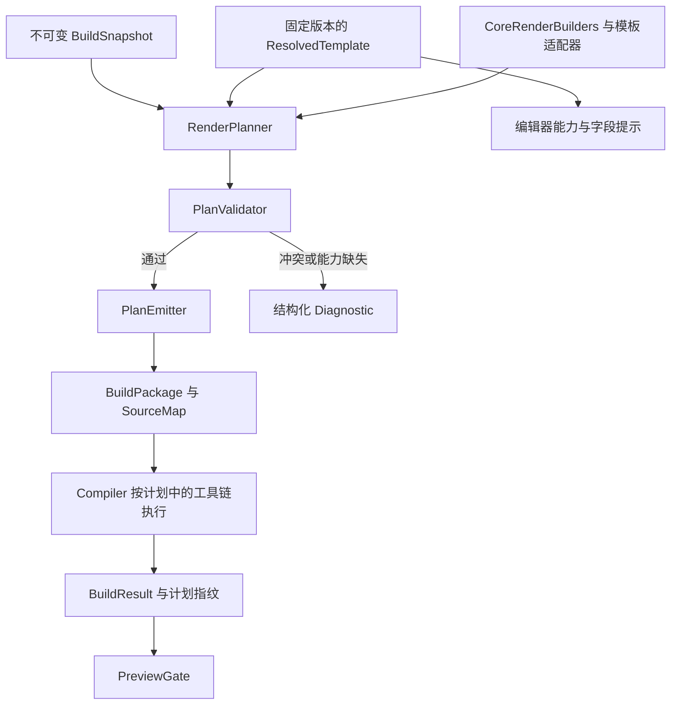

# 模板体系与 LaTeX 生成计划：评估和建议

日期：2026-10-17。状态：已落地第一版生成计划、组件适配、项目模板包导入与固定绑定。

当前实现及使用方式见 [template-import.md](template-import.md)。以下保留完整设计，
包含后续扩展目标；具体类名和首版支持范围以该使用文档及实际代码为准。

已实现 `LatexPlanner → shared_ptr<const LatexGenerationPlan> → LatexEmitter`，
`LatexRenderer` 保留为兼容门面。Generic Article、IEEE Conference 和 Elsevier CAS
各自规划完整的 frontmatter；class、宏包依赖、引用契约、资源内容、编译要求和来源记录
均在输出之前确定。构建快照冻结定义和已验证的外部模板资源字节；GUI 消费同一份定义。

外部包支持 API 1 的受限 manifest，另有针对 CAS 单/双栏官方 ZIP 的内置识别适配。
模板资源保存在项目 `template-resources/<sha256>/` 中，`project.paper` 保存固定绑定；
撤销/重做也恢复绑定。外部模板先经过 ZIP 检查及 Bubblewrap 隔离试编译，再安装。

首版仍把内置模板定义保存在 C++ 注册表中，绑定选项只接受空对象；没有通用片段语言、
任意适配器插件、自动推断任意 `.tex`、作者年份引用 UI 或跨运行时的产物缓存。
生成指纹与实际编译输入摘要用于审计；尚未启用 PDF 缓存复用。运行时依赖的摘要会记录，
运行时整体升级的锁定和迁移策略仍需后续完善。

## 1. 对当前想法的评估

建议采用“通用部分 + 模板专用部分 → 生成计划 → 按计划输出”的方向。
它能把“这个模板应该怎样生成”与“怎样把结构化结果写成 LaTeX”分开，
也便于解释某条生成规则来自哪里、切换模板后改变了什么。

建议补充三个约束：

1. **覆盖只发生在规划阶段。** 通用规则与模板规则先合并、检查冲突，
   得到一份完整、不可变的最终计划。执行器只读取这一份计划。
2. **通用能力不等于 Generic Article 的排版。** 文档遍历、文字转义、
   公式与引用的语义、资源解析、源码映射可以复用；article 的作者排版、
   `geometry` 页边距和关键词格式应属于 article 适配器。
3. **覆盖作用于有契约的组件，而不是生成后的字符串。** 作者与单位、
   关键词所在位置、引用命令与参考文献后端存在关联，不能随意拼接。

推荐组合是：**语义文档 + 模板包 + 模板适配器 + 已解析的生成计划 + 单一输出器**。
相较于原提议，主要改进是把覆盖权限、依赖处理和执行边界明确下来。

计划决定生成的 LaTeX 结构、资源和编译要求；断行、分页与浮动体的最终位置
仍由真实的 LaTeX 类文件和排版引擎计算。这里不另造一套排版引擎。
编译计划固定允许使用的引擎、文献后端和运行模式；`latexmk` 可以按依赖变化
重复运行这些工具，无需在计划中写死运行遍数，但不能临时换成另一套工具链。

## 2. 重构前的代码基线

本节记录方案提出时的状态，供理解重构原因；当前实现范围见开头说明和导入文档。

| 当前实现 | 已有基础 | 需要演进的部分 |
| --- | --- | --- |
| [TemplateRegistry](../src/template/TemplateRegistry.h) | 类名、类选项、导言区、必填字段、能力与工具链要求 | 硬编码注册；缺少版本、资源锁定和组件契约 |
| [LatexRenderer](../src/render/LatexRenderer.cpp) | 文档转义、行内节点、块生成、BuildPackage、SourceMap | 模板解析与字符串输出混在一起；作者和关键词采用统一写法 |
| [BuildSnapshot](../src/build/BuildCoordinator.h) | 不可变 Document、副本中的文献和资源映射、模板 ID、工具链 | 只有模板 ID；没有固定的模板内容及其指纹 |
| [BuildCoordinator](../src/build/BuildCoordinator.cpp) | 验证、生成、编译、结构化事件 | 各阶段仍分别依据模板 ID 查询配置 |
| [ProjectSession](../src/project/ProjectSession.cpp) | 切换模板、revision、历史、异步预览保护 | 模板选择需要扩展为完整绑定，贯穿保存、撤销和快照 |

此前的 IEEE 问题就是职责混合的例子：类文件已经是 `IEEEtran` 的 conference 模式，
但生成器仍将作者单位放入 `\thanks`，关键词也仍输出为普通粗体文本。
**正确的类文件与能够编译成功，都不能代替正确的模板适配。**

当时的工具链声明与实际行为也有差异：IEEE 定义没有显式设置文献引擎，
其字段保留默认 `None`，实际 `latexmk` 构建却会运行 BibTeX。最终构建计划应
明确表达真实意图，不能依靠编译器之后再次猜测。

## 3. 职责怎样划分

| 层次 | 负责内容 | 覆盖边界 |
| --- | --- | --- |
| Document | 作者、机构、标题、正文、公式、引文、交叉引用等语义数据 | 模板切换不改写或删除原数据 |
| CoreRenderBuilders | 遍历、转义、marks 组合、公式边界、标签身份、资源标识、SourceMap 基础 | 可组合复用；模板不能绕过数据类型和安全校验 |
| TemplateAdapter | 作者布局、前置部分顺序、关键词环境、章节和浮动体的输出策略 | 在声明的组件契约内替换通用实现 |
| TemplateProfile | 选择适配器、类选项、组件、宏包策略、文献策略及能力 | 配置有类型、有版本，依赖在规划前解析 |
| RenderPlanner | 将快照、适配器和配置展开成具体生成操作 | 在这里完成所有模板选择与条件分支 |
| PlanEmitter | 将已校验操作序列化为 LaTeX，记录实际行号 | 不查注册表、不补宏包、不选择模板、不修补排版 |
| Compiler | 暂存计划列出的文件，按确定的工具链编译 | 不改变生成策略，不擅自切换引擎 |

字号、栏宽、页边距等通常交给所选 `.cls` 管理；若模板确实需要附加设置，
由它声明。不能在“通用导言区”里先加载 article 的 `geometry`、`caption`、
`natbib`，再让所有模板设法抵消这些设置。
LaTeX 自身也区分可跨文档类复用的 package 与依赖特定排版设计的 class；
这个划分可参照 [LaTeX 类与宏包作者指南，第 2.1 节](https://www.latex-project.org/help/documentation/clsguide.pdf)。

### 模板需要更多元数据时

现有 `Author` 只有姓名、邮箱和机构关联。有的模板可能需要 ORCID、城市、
通讯作者或会议编号，单靠替换 LaTeX 字符串补不齐这些语义。

跨模板有意义的字段，在出现真实需求时扩展 Document 并做 schema migration；
会议编号、审稿模式等模板设置放入有 schema 的 `templateData`。
如果扩展作者关联信息，应引入稳定 AuthorId，避免将长期数据绑在会随排序变化的数组下标上。
在对应模型尚不支持时，报告“不支持的字段”，不能伪造或静默丢弃。

## 4. 推荐的数据流



GUI 的字段提示与构建验证必须消费同一个已解析模板契约。
不能 GUI 根据模板 A 提示字段，而 worker 临时从注册表取得模板 B 的规则。

建议将用户所说的“生成计划”具体区分为以下对象：

| 对象 | 内容 | 生命周期 |
| --- | --- | --- |
| TemplateManifest | 模板包声明、文件清单、适配 API、组件与选项 schema | 随模板包保存 |
| ResolvedTemplate | 固定的包内容、已解析组件、通过 schema 检查的选项、能力契约 | 在抓取快照时固定 |
| DraftRenderPlan | 针对本次 Document 展开的具体操作与依赖 | 单次规划 |
| ValidatedRenderPlan | 无阻断性错误的最终计划；包含输出与编译要求 | 单次构建，可保存诊断副本 |

“通用计划”和“模板计划”可以是规划器内部的规则来源，但不应成为执行阶段
仍要动态交叉合并的两个计划。

### 建议接口形态

以下为概念接口，省略具体 Result 和容器定义：

```cpp
ResolvedTemplate ResolveTemplate(const TemplateBinding&, const TemplateCatalog&);
DraftRenderPlan Plan(const BuildSnapshot&, const ResolvedTemplate&);
Result<ValidatedRenderPlan, Diagnostics> Validate(DraftRenderPlan);
RenderResult Emit(const ValidatedRenderPlan&);
BuildResult Compile(const BuildPackage&, const ResolvedCompileSpec&);
```

`Emit()` 不再接收 `template_id` 或裸 `Document*`，也不能访问全局
`TemplateRegistry::Instance()`。模板适配器只能在规划阶段运行；最终计划中
不能留下“到执行时再调用 adapter”或“再判断有没有 bibliography”的回调。

标签表、资源别名表等中间状态属于单次规划的局部上下文，避免当前 renderer 的
`mutable` 映射变成跨构建共享状态。

## 5. 覆盖规则必须明确

### 5.1 来源与优先级

```text
不可覆盖的语义与校验约束
                ↓ 约束所有来源
Core 默认组件 → 模板 Profile 的显式组件选择 → Profile 允许的项目选项
```

项目选项仅能填写 Profile 暴露的选项，例如纸型、审稿模式。
它不能以“优先级更高”为由覆盖模板禁止的宏包或绕过校验。
如需项目专用排版覆盖，应形成一个可保存、可锁定的派生模板包，经过同一套解析流程。

首版不需要任意多继承。允许模板使用 Core 组件，允许单一父 Profile 的受控派生；
父项必须固定版本和摘要。检测继承环，不按文件名、发现顺序或安装时间决定优先级。

### 5.2 不同配置使用不同合并语义

| 配置类别 | 合并规则 |
| --- | --- |
| document class、主布局、前置部分组件 | 唯一值或整体替换；不能同时保留两个实现 |
| 引用与文献策略 | 原子替换整组契约，包括命令、宏包、样式、后端与显示策略 |
| paragraph、figure 等节点组件 | 按组件名替换；必须满足相同语义契约 |
| required / forbidden 宏包 | 合并约束后求解；冲突即报错 |
| 宏包选项 | 仅合并声明为兼容的选项；互斥或未知组合不能“最后一个覆盖” |
| 输出顺序 | 使用明确的布局树或 before/after 依赖；拒绝环和不存在的锚点 |
| 用户选项 | 选项值覆盖默认值，但必须通过类型、取值和约束校验 |
| 模板资源文件 | 按明确目标路径布置；同一路径内容冲突必须显式解决 |

“覆盖”应记录替换对象及来源。未知组件名、错误的契约版本必须报错，不能因为拼错
`frontMatter` 就退回 article 的作者写法。

### 5.3 需要原子协调的组件

**前置部分**不只有一段 `author` 字符串，还包含作者和机构分组、标题生成时机、
摘要和关键词放在哪里、是否需要外层环境。由一个 front-matter 组件协调这些子项；
模板可以在其契约内提供关键词子组件，不能跨布局家族随意混用。

**引用与文献**不只有一个 `.bst` 名字。引用命令、排序压缩方式、文献引擎、
参考文献输出命令及 GUI 显示标签必须是一组相容选择。不能只改成 `\cite`，
却遗漏已有 `CitationMode::Narrative` 的含义；缺少对应实现时应给出能力诊断。

## 6. 计划表达什么

建议使用面向本产品的小型结构化中间表示，而非完整的 LaTeX 语法树。
它应能表达 class、宏包、命令参数、环境、文字、公式、标签、资源和来源信息。

```cpp
struct RenderPlan {
    PlanSchemaVersion schema;
    InputFingerprints inputs;
    TemplateBinding binding;
    ResolvedCompileSpec compile;
    std::vector<PackageLoad> packages;
    PlanNode output;                         // 所有选择均已展开
    std::vector<VerifiedResource> resources; // 固定内容或稳定的内容存储句柄
    std::vector<ResolutionRecord> provenance;
};

struct PlanNode {
    SourceOrigin origin; // Document 节点/字段，或模板文件/组件
    std::variant<Text, InlineMathBody, Command, Environment,
                 Label, Reference, AssetPath, TemplateLiteral> value;
};
```

`Command` 的参数可以包含子节点；`Environment` 包含有序子节点。这里的类型是示意，
正式实现需用前置声明或指针处理递归关系，并用构造接口保证合法形态。

关键要求如下：

- `Text` 只允许输出器按固定规则转义一次。模板不能将用户姓名、标题直接转换成原始 TeX。
- `InlineMathBody` 保留现有公式校验与生成边界，不走普通文字转义。
- label、citation key、路径分别校验，不能用同一种字符串替换处理。
- `TemplateLiteral` 只能来自固定模板资源或内置组件，并保留来源摘要；摘要不等于安全认证。
- 加粗、斜体、行内公式、引用和交叉引用的语义不得因组件替换而消失。
- 正文节点必须被覆盖检查：正常输出、明确策略性隐藏，或报告不支持；不能静默漏掉节点。
- 隐藏作者等审稿策略只影响输出计划，不删除原 Document 中的作者信息。

计划的布局可以声明 `beforeClass`、导言区、文档内部等合法阶段，不能把“class 必须
永远是第一行”作为系统硬约束。前置部分内部的先后顺序由所选布局决定；输出器
不固定为当前的“title → author → maketitle → abstract → keywords”。

### 计划校验与宏包依赖

至少检查：唯一 class、唯一 document 外层、环境嵌套、组件能力、标签唯一性、
资源完整性、包选项冲突，以及加载顺序图无环。记录由 class 已提供的能力，
但这些声明也需要模板实际编译测试支撑。

例如不能同时带入 article 的一英寸页边距设置与一个要求类文件自行控制版心的模板；
也不能对已经由类加载的宏包再次无条件传入不同选项。
依赖求解失败应在编译前给出来源明确的诊断，而不是拼出两套导言区碰碰运气。
加载顺序图有多个合法解时使用稳定的组件 ID 作为次序依据；声明为顺序敏感的选项
保留显式顺序，不能为了规范化而随意排序。

这些检查不能静态证明任意 TeX 宏都正确；真实编译与输出检查仍不可省略。

### SourceMap 应随计划自然形成

每个生成片段在规划时携带 `SourceOrigin`，输出器落笔时记录真实文件和行号。
来源至少区分：正文 NodeId、前置字段路径、模板组件、模板资源文件。
当前 Author 没有稳定 ID，单次快照中的字段路径可以使用索引，但必须绑定快照身份。

编译器错误位于作者块时，能指向作者/机构字段；错误位于模板 `.sty` 时，
应指向模板问题，而不是错误地跳到最近的正文段落。
同时导出 `resolved-plan.json` 和组件来源记录，便于解释“为什么用了这一条规则”。
序列化计划用于调试和审计；首版不接受用户任意修改后直接执行。

## 7. IEEE 的具体例子

两个适配器共享文字、正文、公式、资源和 SourceMap 基础，但分别声明前置部分：

| 组件 | Generic Article | IEEE Conference |
| --- | --- | --- |
| class | `article` 及其选项 | `IEEEtran` 的 `conference` 选项 |
| 作者与单位 | article 适配器自行实现 | 使用相容的 `IEEEauthorblockN` / `IEEEauthorblockA` 等结构 |
| 关键词 | article 定义的格式 | `IEEEkeywords` 环境 |
| 版心与字号 | article Profile 的设置 | 优先交由 IEEE 类及其合法选项控制 |
| 引用与文献 | 独立声明相容策略 | 独立声明 IEEE 策略，覆盖命令到后端的完整组合 |

这里可以复用 Core 的默认 paragraph 组件，但不继承 Generic Article 的整套导言区。
IEEE 的前置部分一经替换，通用层不得再补一次 `\thanks` 或 `Keywords:`。

实际类文件为 [IEEEtran 模板包](https://ctan.org/pkg/ieeetran)的一部分。
应同时验证“加载了哪个类文件”和“是否按该类的接口生成”，这两项是独立检查。

## 8. 模板包与导入

### 8.1 模板包由资源和适配声明共同组成

建议的包布局如下；首版可先将内置模板迁入同一格式：

```text
ieee-conference/
├── template.json
├── IEEEtran.cls
├── IEEEtran.bst
├── LICENSE
└── fixtures/
    └── minimal.paper
```

内置资源目录可放在仓库的 `resources/templates/`；C++ 解析和规划代码仍放在
`src/template/`、`src/render/`。这是建议新增的布局，不是当前目录状态。
应用模板目录用于安装共享包，项目中另存固定副本或可随项目备份的内容存储。

下面是协议示意，具体字段应在实现时形成 JSON Schema。组件 ID 是建议名称，
只有宿主真正注册对应 API 后才能使用，不能靠导入一个 JSON 声称已支持。

```json
{
  "manifestSchemaVersion": 1,
  "renderApiVersion": 1,
  "id": "org.paperforge.ieee-conference",
  "version": "1.0.0",
  "name": "IEEE Conference",
  "profile": "conference",
  "documentClass": {
    "name": "IEEEtran",
    "options": ["conference"]
  },
  "components": {
    "frontMatter": "ieee.conference.front-matter@1",
    "paragraph": "core.paragraph@1",
    "figure": "core.figure@1",
    "citations": "ieee.numeric@1"
  },
  "toolchain": {
    "engine": "pdflatex",
    "bibliographyEngine": "bibtex"
  },
  "bibliographyStyle": "IEEEtran",
  "capabilities": {
    "maxHeadingDepth": 3,
    "figureSpans": ["single-column", "double-column"]
  },
  "requiredFields": ["title", "authors", "affiliations", "abstract", "keywords"],
  "options": {
    "paperSize": {
      "type": "enum",
      "values": ["letterpaper", "a4paper"],
      "default": "letterpaper",
      "applyTo": "documentClassOption"
    }
  },
  "files": ["IEEEtran.cls", "IEEEtran.bst", "LICENSE"],
  "fixtures": ["fixtures/minimal.paper"]
}
```

示例中的 requiredFields 是产品 Profile 的要求；具体会议可建立不同 Profile。
宏包需求、禁用包、加载顺序与可支持的 citation mode，由组件契约补足。
组件的文献配置与 manifest 中的文献配置必须相容，不能各自决定一次。
`None`、BibTeX、Biber 的选择最终要明确；未实现的后端应标记不支持，不能只改启动参数。
实际是否需要执行文献处理，也应根据本次文档和文献输入在最终计划中确定。

模板资源可声明从固定运行时取得，但构建记录必须保存解析到的路径、版本和摘要。
若要求跨机器严格复现，应该固定运行时版本，或在许可允许的前提下随包携带必要文件。

### 8.2 “导入现成模板”与“导入任意 LaTeX 压缩包”应区分

| 导入对象 | 可以承诺的行为 |
| --- | --- |
| 有兼容 manifest 的模板包 | 校验协议、组件和资源，解析为生成计划并验证 |
| `.cls`、`.sty`、`.bst` 与示例 `.tex` | 识别为模板资源，进入“需要适配”状态 |
| 带完整适配声明的高级模板 | 在宿主支持的声明语言范围内展开；未知能力明确拒绝 |

**不能承诺任意 publisher ZIP 导入后就能自动正确生成结构化论文。**
示例中的作者宏、环境顺序、必填信息和语义绑定不能仅凭文件名或正则可靠推断。
导入向导可以帮助选择已有适配器、填写绑定、展示试排结果；适配未完成前不标记为可用。

### 8.3 导入的处理顺序

```text
暂存输入 → 检查文件与路径 → 校验 manifest / API → 固定资源内容
       → 解析组件和依赖 → 生成 fixture 的计划 → 在受控环境试编译
       → 检查声明的输出特征 → 安装为明确版本 → 用户选择后绑定项目
```

建议区分“需要适配”“依赖不满足”“待试排验证”“声明范围内验证通过”等状态。
“验证通过”只覆盖包声明和测试的能力，不等于符合所有会议的投稿要求。
导入一个新版本也不自动替换当前项目的绑定。

文件检查包含相对路径、链接逃逸、重复目标名、大小/数量限制和资源摘要。
模板包不能携带宿主执行的安装脚本、任意编译命令，或将文件写进应用运行时。
构建时仅暂存计划列出的文件，并检查它们与固定摘要相符。
安装先在临时目录完成检查，再发布不可变的包目录；失败时保留已安装版本，
不原地改写一个仍被项目或构建引用的包。

模板 `.tex/.cls/.sty` 在编译时仍是代码。禁用 shell escape 是基础限制，
不能据此宣称隔离了所有文件访问；外部模板试编译还需要进程与文件系统边界、
网络限制、资源上限和受控子进程。相关基础分别见
[Web2c 的 shell escape 文档](https://www.tug.org/texinfohtml/web2c.html)
和 [TeX Live Guide 的安全说明](https://tug.org/texlive/doc/texlive-en/texlive-en.html)。
首版若未提供足够的执行隔离，应限制外部包的自动试编译/启用范围，明确能力边界。

### 8.4 是否引入模板语言

第一阶段用内置 C++ 组件加 manifest 选择器，已能承载不少共享布局的类文件。
当真实模板确实超出这些组件时，再增加受限的声明式片段：只允许字段读取、
有限的条件与列表遍历、命令/环境构造、已注册的组件调用。

片段在规划阶段展开为相同的 PlanNode；模板字段绑定仍保留类型和来源。
不开放任意宿主脚本或 native plugin，也不构建一个通用编程语言。
需要未支持的新语义、新布局能力时，扩展宿主 API 并补测试。

## 9. 模板切换、保存与复现

### 9.1 从字符串 ID 升级为固定绑定

```cpp
struct TemplateBinding {
    TemplateId id;
    PackageVersion version;
    ContentDigest package_digest;
    ProfileId profile;
    ValidatedOptions options;
};
```

manifest schema 版本、适配 API 版本、模板包版本、类文件版本是不同概念。
同一个版本号也不能代替内容摘要；摘要只能固定内容，不能证明发布者身份。

项目保存完整绑定和所需模板资源。建议使用项目内的 `template-resources/` 与
`template.lock.json`，并纳入项目备份/导出；不要只存在会清理、会被忽略的
`.paperforge/` 缓存中。模板版本缺失时提示恢复依赖，不自动取“最新版本”顶替。
旧项目的裸模板 ID 通过迁移绑定到明确的内置 Profile，不能静默绑定未知的新格式。

`project.paper` 中的 TemplateBinding 是绑定的权威数据，所引用的资源清单按摘要
不可变保存。根目录的 `template.lock.json` 是供查看、导出的派生清单；它与绑定
不一致时提示并根据绑定和已验证资源重建，不能用其中另一个版本替换绑定。

按同一个保存快照，先发布不可变资源及其清单，再原子提交项目主文件，最后更新
派生 lock 文件。崩溃最多留下未引用资源或滞后的派生清单；不能让已保存项目指向
尚未发布的包，也不能先覆盖一个权威 lock 文件而使旧项目绑定失效。

### 9.2 模板切换是一条项目编辑操作

通过编辑命令、历史和持久化处理完整 TemplateBinding，统一更换模板、版本、选项
以及必要的模板设置通知。撤销时恢复旧绑定；旧版本仍被项目、历史或在途构建引用时不能清理。

模板切换不删除深层标题、作者单位或引用。不兼容的内容通过诊断说明。
草稿缺少必填字段可以允许先选择模板并显示待补信息；在达到生成要求之前，构建被阻断。
未知模板 API、不可用适配器或非法选项则不能作为有效绑定启用。

如支持双盲审稿等选项，原始作者信息保留在文档里，由输出计划显式决定隐藏。
重新选择另一个模板时，也保留原模板的独立设置，避免在几个模板之间来回切换造成丢失。

### 9.3 不可变快照和构建身份

沿用 [现有单一所有者与异步快照约束](architecture-async.md)：应用线程固定文档、
模板绑定和选项，worker 只读不可变对象。模板文件应由不可变内容存储持有，
不能只是把一个可能被覆盖的安装路径传给后台线程。
图片等外部资源也应以稳定内容或摘要捕获；暂存时发现内容变化，必须报告并重试快照。

建议记录两个指纹：

- 生成指纹：文档/文献/图片内容、模板包摘要、Profile、规范化选项、规划/输出协议版本。
- 编译指纹：生成指纹，加运行时身份、实际编译要求和相关资源版本。

计划可另外保存规范化内容的摘要；摘要计算排除自身字段、build ID、时间戳和机器绝对路径。
同样输入应产生同样的规范化计划与生成源码，不要求含时间戳的 PDF 二进制逐字节相同。

BuildResult 保留原有 project / revision / snapshot / build 身份，并携带模板与计划指纹。
PreviewGate 必须拒绝旧绑定、旧选项和旧包内容的迟到结果。
“安装一个新模板版本”不修改当前绑定；“项目切换到新版本”必须增加 revision。

### 9.4 编辑器引文显示也要一起演进

当前编辑器按首次引用顺序编号。将来选择按字母序排列或 author-year 的模板时，
不能继续把原来的数字标签当成 PDF 中的真实编号。

引用策略契约要声明可支持的 GUI 表现。无法在生成前精确确定的标签，需从匹配本次
指纹的编译结果中解析；构建前显示中性的引用标识或明确的待更新状态。
复杂排序和姓名消歧不能只根据 `.bst` 文件名自行猜测。

## 10. 与其他方案的比较

| 方案 | 优点 | 主要代价 | 建议 |
| --- | --- | --- | --- |
| 在 LatexRenderer 中继续加模板 ID 分支 | 两三个修补点上手快 | 分支蔓延、宏包与布局混合，难导入 | 只适合过渡 |
| 每模板复制一个完整 renderer | 自由度高 | 转义、公式、引用、SourceMap 多份实现易分叉 | 不作为主架构 |
| 每模板一个大字符串模板 | 外部文件容易编辑 | 用户值转义、嵌套结构、依赖和字段来源难保证 | 仅作为受限片段的输入形式 |
| 动态脚本或 native plugin | 表达能力强 | ABI、兼容性、执行隔离、调试成本高 | 暂不引入 |
| 组件适配器 + manifest + 最终计划 | 复用语义基础、可解释、可校验、可固定版本 | 增加组件契约、计划类型与测试矩阵 | 推荐 |

该方案不是零成本：依赖求解、模板兼容性验证和版本迁移都需要维护。
应先以两个现有模板证明边界，再按真实需求扩大声明语言，避免先建设庞大的插件平台。

## 11. 建议落地顺序

### 阶段一：用两个现有模板打通计划链路

提取 CoreRenderBuilders，分别建立 GenericArticleAdapter 与 IeeeConferenceAdapter；
引入最小的 typed plan 和只读输出器。先修复 IEEE 作者/单位与关键词，验证“整体替换
专用组件后，Core 不再补回旧行为”。外部 manifest 和片段语言不作为本阶段前提。

保留 `LatexRenderer::Render()` 作为过渡门面，内部调用规划、校验、输出，
使 BuildCoordinator 和现有测试可逐步迁移；最终核心输出器不再查询注册表。

### 阶段二：配置、依赖和固定版本

将内置模板配置迁入 manifest，建立 TemplateCatalog/Resolver；
落实宏包与引用策略契约、模板绑定、资源摘要、项目迁移、历史与预览指纹。
GUI 的字段和能力提示改为消费解析后的统一契约。

### 阶段三：导入能由现有组件表达的模板包

增加安装目录、项目资源保存、导入向导、静态校验与受控试编译。
裸 `.cls/.tex` 进入“需要适配”，不假装已经自动支持。
将编译环境隔离作为外部模板自动执行的前置条件。

### 阶段四：按真实模板扩展适配能力

优先扩充可复用组件；确有必要时增加受限片段语言或新语义字段。
每个新增能力都形成明确的 API、fixture 和兼容性测试，不用更多任意字符串开关补洞。

建议模块位置：

| 模块 | 建议位置 |
| --- | --- |
| manifest、固定绑定、目录解析与模板包安装 | `src/template/` |
| Core builders、计划类型、规划器、校验器、输出器 | `src/render/` |
| 可被 template 与 build 共同引用的工具链值类型 | 独立契约头文件，例如 `src/core/ToolchainSpec.h` |
| 项目绑定保存与迁移 | `src/persistence/`、`src/project/` |
| 按计划执行、资源暂存、运行时检查、执行隔离 | `src/build/` |
| 模板选择、导入向导、字段提示与诊断 | `src/app/` |

这也能移除当前 `template → build/Toolchain.h` 的方向依赖；模板与编译器引用
共同的值类型，不相互引用具体实现。

## 12. 验收依据

| 场景 | 必须验证的结果 |
| --- | --- |
| 两个现有模板生成同一论文 | 语义内容不丢；各自的前置部分正确 |
| IEEE 作者与共享机构 | PDF 中可提取预期单位；没有依靠启用 `\thanks` 绕开作者适配 |
| IEEE 关键词 | 使用对应环境；没有重复的普通 Keywords 输出 |
| 真实模板加载 | `.fls` / 日志中的 class、style 来源与计划的资源绑定相符 |
| 加粗/斜体/公式/交叉引用 | 模板切换前后语义一致，特殊字符只转义一次 |
| 宏包或选项冲突 | 规划阶段给出两方来源，不交给编译器隐式决定 |
| 字段或 citation mode 不支持 | 明确诊断，不静默删除或改变含义 |
| A → B → A 与 Undo/Redo | 恢复绑定和选项，Document 内容保持完整 |
| 构建中切换模板/更新包 | 旧结果不能进入当前预览，快照内容不漂移 |
| 重装相同 ID 的新版本 | 已固定项目不自动换版本；缺失依赖不静默替代 |
| 导入不完整包或只有示例 `.tex` | 保持待适配状态，不标记为完整支持 |
| 非法路径、重复目标、资源被替换 | 暂存/校验阶段拒绝，不影响已有包 |
| 模板组件或资源内编译错误 | SourceMap/诊断指向模板来源，而非误指正文 |
| 文献排序规则改变 | GUI 标签与所采用策略一致，不沿用错误旧编号 |
| 同样输入再次生成 | 规范化计划和 LaTeX 稳定，来源信息可追溯 |

测试组合应包括计划结构断言、生成源码快照、真实编译、PDF 文本检查与代表性版式截图。
不能仅以“编译退出码为 0”作为模板正确性的验收标准，也不宜直接比较整个 PDF 的二进制哈希。

## 13. 建议采纳的架构决策

采用用户提出的生成计划方向，落实为：**通用语义组件与模板专用组件先解析、展开和校验，
再交给单一输出器执行最终只读计划；模板资源与编译要求随同一份固定绑定进入构建。**

先用 Generic Article 与 IEEE Conference 验证方案，随后开放模板包导入。
避免将 article 的具体排版视为通用默认，避免输出器二次推断模板，也避免把任意 LaTeX
压缩包导入误等同于自动完成模板适配。
